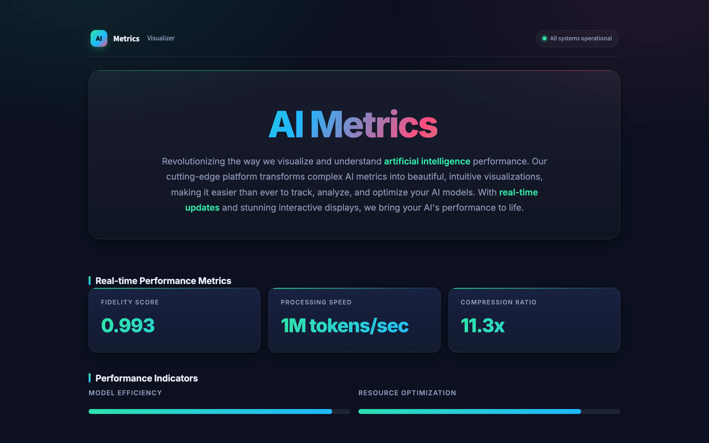
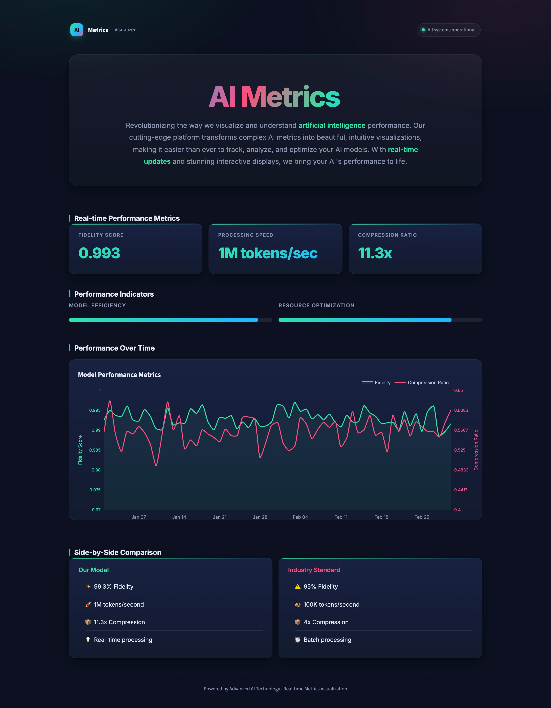
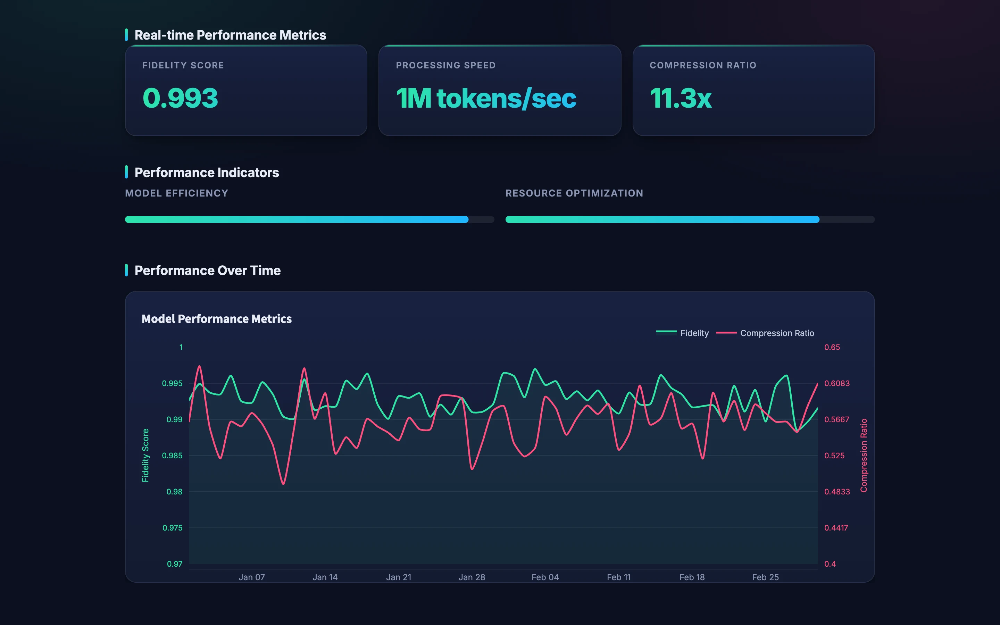
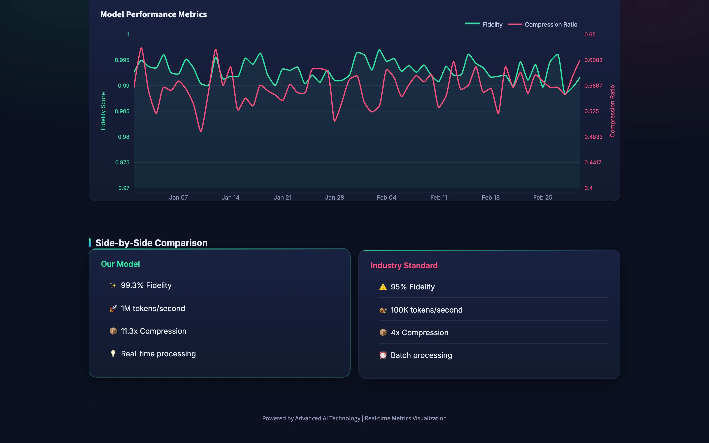

<div align="center">

# AI Metrics Visualizer

**Marketing-ready dashboard for AI model performance metrics: animated counters, dual-axis trends, and model comparison—all hard-coded demo data, no backend.**

**Python**<br/>Streamlit · Plotly · Pandas · NumPy


<table>
  <tr>
    <td></td>
    <td></td>
  </tr>
</table>
<sub>Screenshots are real captures of a local build running on fictional demo data.</sub>

</div>

---

## Product at a Glance

| | |
|---|---|
| **What it is** | Single-page Streamlit dashboard showcasing AI model metrics via animated UI, interactive charts, and model comparison cards |
| **Stack** | Python, Streamlit, Plotly, Pandas, NumPy; custom CSS with keyframe animations and glassmorphism |
| **Data** | Hard-coded metrics (fidelity 0.993, 1M tokens/sec, 11.3x compression); synthetic trends regenerated on each run |
| **UI/UX** | Animated typing intro, incrementing metric counters, dual-axis performance chart, progress bars, side-by-side model comparison |
| **Backend** | None; all rendering is client-side in the browser |
| **Lines of code** | ~430 lines (single app.py file) |

## Product Showcase

<table>
  <tr>
    <td align="center"><br/><sub><b>Animated Intro</b><br/>Typing animation, gradient text</sub></td>
    <td align="center"><br/><sub><b>Metrics & Progress</b><br/>Animated counters, efficiency bars</sub></td>
    <td align="center"><br/><sub><b>Performance Chart</b><br/>Dual-axis trend, interactive hover</sub></td>
    <td align="center"><br/><sub><b>Model Comparison</b><br/>Our model vs industry baseline</sub></td>
  </tr>
</table>

## Key Features

- **Animated intro.** CSS keyframe typing animation for the dashboard title with gradient text effect.
- **Metric counters.** Three animated KPI cards (fidelity, throughput, compression) that increment from 0 to final value over ~2 seconds.
- **Progress indicators.** Visual progress bars for model efficiency (93%) and resource optimization (85%).
- **Performance chart.** Dual-axis Plotly time series tracking fidelity (0–1 scale) and compression ratio (4–11.3 scale) across 60 days of synthetic data.
- **Model comparison.** Side-by-side cards listing features of the built model versus an industry standard.
- **Dark UI design.** Glassmorphism, backdrop blur, gradient backgrounds, and responsive layout.
- **No configuration.** Zero backend, no auth, no external APIs; runs as a single Streamlit file.

## Architecture

All rendering is synchronous and contained in one Streamlit script:

```
Page config → CSS injection → Animated intro → Metric counters → Progress bars → Plotly chart → Comparison cards
```

Each element (typing animation, counter increments, progress fills, chart render) is self-contained with minimal dependencies. Synthetic data is generated fresh on each page load to simulate "live" metrics.

Details: [docs/ARCHITECTURE.md](docs/ARCHITECTURE.md).

## Engineering Highlights

- **Animated counters without JavaScript.** Python loops update a Streamlit placeholder with incrementing values and millisecond delays, creating smooth count-up effects without frontend logic.
- **CSS-only typing animation.** The intro text uses pure CSS keyframes with custom properties to sequence letter-by-letter reveal and a blinking cursor.
- **Dual-axis charting.** Plotly overlays two different scales (fidelity 0–1, compression 4–11.3) on a single chart with responsive legend and hover tooltips.
- **Single-file simplicity.** ~430 lines of Python in one file; trivial to fork, extend, or repurpose as a template for other marketing dashboards.

More: [docs/ENGINEERING_CHALLENGES.md](docs/ENGINEERING_CHALLENGES.md).

## Status & Scope

**Demo mode.** This is a portfolio showcase dashboard with no real AI backend, database, or persistent state. All metrics are hard-coded; the trend chart draws synthetic data (random normal distribution) on each session. The value is in the UI/UX design and visualization patterns—how to present static data as animated, engaging, "live" dashboards.

**Python version:** Runs on Python 3.12+ with current Streamlit, Plotly, Pandas, and NumPy. Original pinned versions (Streamlit 1.32, Pandas<2, NumPy<1.25) do not install on Python 3.13+; update or remove version pins for modern setups.

**Animation load time:** ~5–8 seconds on first run as counters, progress, and CSS animations complete sequentially.

**Known limitations:**
- Synthetic data regenerates on each page load; seed the random generator or connect a database for persistence.
- CSS gradient text uses WebKit vendor prefixes; Firefox support is present but less smooth.
- Streamlit 1.36+ deprecates `use_container_width`; harmless warning on newer versions.

## Documentation

| Read | For |
|---|---|
| [Technical case study](docs/TECHNICAL_CASE_STUDY.md) | Design challenge and solution walkthrough |
| [Architecture](docs/ARCHITECTURE.md) | Rendering pipeline and tech stack |
| [Engineering challenges](docs/ENGINEERING_CHALLENGES.md) | Python compat, synthetic data, animation trade-offs |
| [Product overview](docs/PRODUCT_OVERVIEW.md) | Features, sections, and content breakdown |
| [Privacy and source](docs/PRIVACY_AND_SOURCE.md) | Data policy and third-party licenses |

## Source Code

This repository is a portfolio showcase for a custom application. The source code is private. See [RIGHTS.md](RIGHTS.md) for usage terms.
