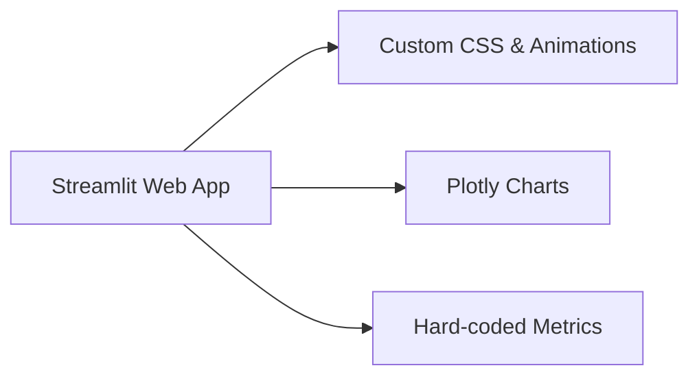

# Architecture

The application is a single Streamlit script with no back-end services, databases, or auth. All rendering is synchronous and runs in the browser.

## 1. Structure

## 2. Rendering pipeline

1. **Page config.** Streamlit sets page title, layout (wide), sidebar (collapsed), and icon.
2. **CSS injection.** Keyframe animations and style rules are embedded in the HTML via `st.markdown()`.
3. **Animated intro.** Typing animation and gradient text render via pure CSS.
4. **Metric cards.** Python loops iterate 25 times per metric, updating a placeholder with incrementally higher values; `time.sleep(0.075)` creates the count-up effect.
5. **Progress bars.** Native Streamlit progress components fill in 85–93 steps with 0.01s delays.
6. **Chart.** Plotly figure is generated once from synthetic data (np.random.normal) and rendered with responsive layout.
7. **Comparison section.** Static HTML cards styled with CSS classes.

## 3. Technology stack

- **Streamlit:** Web framework for Python data apps.
- **Plotly:** Interactive graphing library for the dual-axis chart.
- **Pandas & NumPy:** Data generation and manipulation.
- **streamlit-extras:** Card styling (unused in final version due to custom CSS).
- **CSS3:** Keyframe animations, gradients, backdrop blur, glassmorphism.

No external API calls, no persistent state, no user input.
